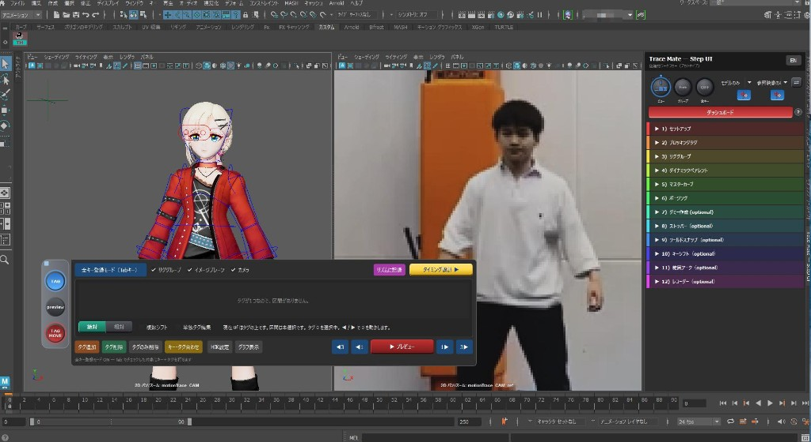
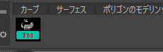

# Trace Mate

Maya 向けアニメーション学習ヘルパー（Windows）。

ソースコードは非公開です。配布物はコンパイル済みの `.pyc` とインストーラのみです。

## マニュアル

👉 **[使い方マニュアル（第1稿）](docs/manual.md)**

## ダウンロード（必須）

**自分の Maya バージョン用の zip を [Releases](https://github.com/matu1004-ctrl/TraceMate/releases) から取得してください。**

| Maya | ファイル |
|------|----------|
| 2025 | `TraceMate_Maya2025_Windows.zip` |
| 2026 | `TraceMate_Maya2026_Windows.zip` |
| 2027 | `TraceMate_Maya2027_Windows.zip` |

`.pyc` はバージョン専用です。違う年の zip では動きません。

## インストール

1. 上記 zip を解凍する  
2. フォルダ内の **`install.mel` を Maya のビューポートへドラッグ＆ドロップ**  
3. シェルフに **TM** ボタンが追加される  
4. ボタンを押して起動  

コピー先の例:

`Documents\maya\<バージョン>\ja_JP\scripts\TraceMate\`

## 注意

- 改変したものを再配布しないでください（[LICENSE](LICENSE) 参照）  
- アンインストール: 上記 `TraceMate` フォルダを削除し、シェルフの TM ボタンを削除  

## ライセンス

[LICENSE](LICENSE) を参照してください。個人・商用の利用は可。ソースの公開・改変版の配布は不可です。
