# Trace Mate マニュアル（第1稿）

Windows / Autodesk Maya 2026・2027 向け。  
この文書は学習用ヘルパーとしての使い方を説明します。Optional 機能は概要のみです。

---

## 0. はじめに

### このツールは何か

Trace Mate は、**学習補助用のヘルパー**です。学生の練習用を想定していますが、再学習にも使えます。

### 「トレース」について（誤解の防止）

ここでいう「トレース」は、既存の作品や実写をなぞって自分の作品にすることではありません。

意味しているのは次のような練習です。

- 既存の作品や実写ビデオの中から動きを研究し、理解する
- 同等のなにかを作り出す手指の繊細さ（作業の解像度）を獲得する

このツールもその目的のために作られています。  
とはいえ、トレースエクササイズ以外にも有効な機能もあります。

### なぜこのツールを作ったか

設定だけで手間のかかる作業を、なるべく簡易にできるようにしました。  
設定に必要だった時間を、あれこれ悩むことではなく、**エクササイズ時間を増やすこと**に使ってほしい、という意図です。

3Dアニメーターに必要なのは、結局は絵心と動き心です。  
それはツールのことで悩むことでも、生成AIに任せて自分の腕で作らない練習でもありません。  
**自分の手で具体的に作業すること**でしか、自分の中に開発できません。

経験上、習得の難易度が高いところ・苦手になりやすい部分を、やりやすく補助します。

同じ目的のことを異なる方法でやってみることは、一つの方法しか知らないよりタイパが良いです。理解が深まり、想定外への幅も広がります。再学習の意味もあります。

### このマニュアルの範囲

| 扱う | 扱わない（概要のみ） |
|------|----------------------|
| インストール、画面、基本の流れ | Optional 各機能の詳細手順 |
| ステップ 1〜6 | ダミー作成〜レコーダーの詳説 |

### 対応環境

- OS: Windows
- Maya: 2026 / 2027（[Releases](https://github.com/matu1004-ctrl/TraceMate/releases) のバージョン別 zip）

---

## 1. インストールと起動

### ダウンロード

[Releases](https://github.com/matu1004-ctrl/TraceMate/releases) から、自分の Maya 年の zip を取得します。

| Maya | ファイル |
|------|----------|
| 2026 | `TraceMate_Maya2026_Windows.zip` |
| 2027 | `TraceMate_Maya2027_Windows.zip` |

### インストール

1. zip を解凍する  
2. 中の **`install.mel` を Maya のビューポートへドラッグ＆ドロップ**  
3. シェルフに起動ボタンが追加される  

### 起動

シェルフの **TM**（Trace Mate）ボタンを押します。

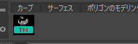

### アンインストール

1. `Documents\maya\<バージョン>\ja_JP\scripts\TraceMate\` フォルダを削除  
2. シェルフの TM ボタンを削除  

---

## 2. 画面の見方

### 全体

典型的な作業画面は、左にモデル・右に参照映像の二画面と、右側（またはドック）の Step UI です。

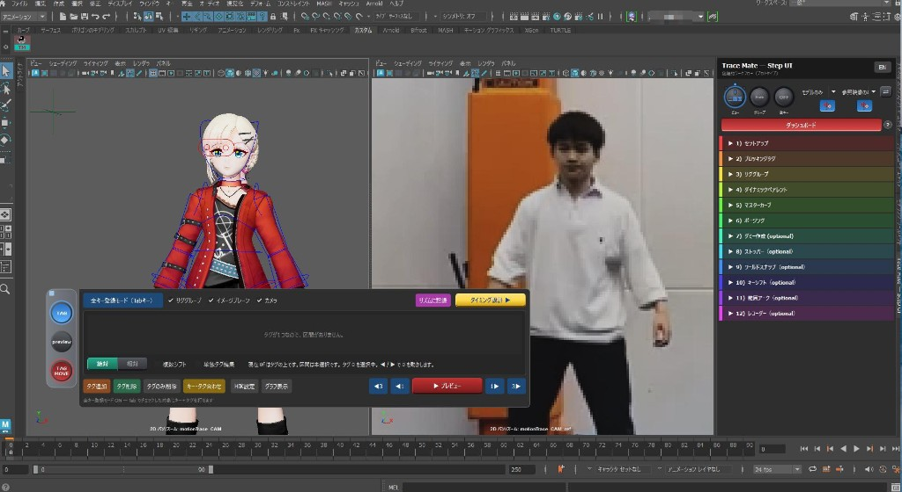

### ステップ一覧

左側（またはドック）に、番号付きのステップが並びます。クリックで開閉します。

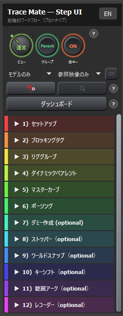

上部には次のような操作があります。

- **ビュー** … 通常 / 二画面 / 奥行き
- **グループ** … Parent / Free
- **全キー** … 全キー登録モード（Tab）の ON / OFF
- **ダッシュボード** … 補助パネルの表示／非表示
- **EN / JA** … UI 言語
- 他に標準機能の2Dパン・ズームに素早くアクセスできるボタンもあります。

---

## 3. 基本の流れ

おすすめの順番は次のとおりです。

1. セットアップ  
2. ブロッキングタグ  
3. リググループ  
4. ダイナミックペアレント  
5. マスターカーブ  
6. ポージング  

7 以降の **(optional)** は補助用です。通常の学習フローでは必須ではありません（詳細は本マニュアルの対象外）。

---

## ダッシュボードの使い方

基本的な操作はここから行えます。  
ダッシュボードはさらに左上の四角い部分で最小化され、基本的な操作はボタンで行えます。  
モードは一番上のボタンを押すたびに順番に切り替わります。

| モード | 内容 | 画像 |
|--------|------|------|
| RIG | 親子状態と各リグの自由な状態を切り替えられることと、状況に対応したプレビューのボタンがあります。 | 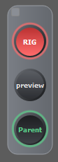 |
| TAG（タグ編集時） | タイムスライダー上のタグを移動させてシーンのタイミングを変えるボタンがあります。 | 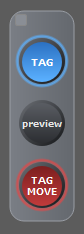 |
| TAG（タイミング構築時） | タイミングの記録の開始ボタンがあります。 | 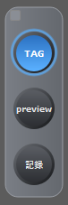 |
| POSE | 中間ポーズ作成の基準になる二つのポーズの登録ボタンと、任意のフレームに中間ポーズを作成するボタンがあります。 | 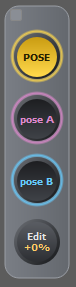 |

各モードの設定や追加機能は、ダッシュボードの各パネル上にあります。

---

## 4. 各ステップの使い方

### 4.1 セットアップ

**目的:** トレース用カメラと参照映像（イメージプレーン）を短時間で整える。

**事前条件:** 作業用のキャラ／シーンがあること。参照用の連番画像または動画があること。  
（画像は連番シーケンスファイル。名称は「英文字のファイル名.[####].拡張子」になります）

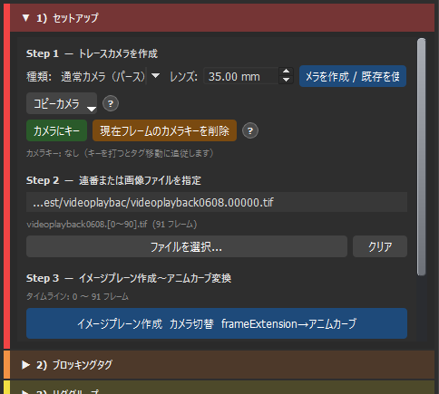

**操作の流れ**

1. **トレースカメラを作成**  
   種類・レンズを確認し、「カメラを作成 / 既存を使う」などを実行する。  
2. **連番または画像ファイルを指定**  
   「ファイルを選択…」で参照素材を選ぶ。  
3. **イメージプレーン作成〜アニムカーブ変換**  
   青い実行ボタンで、イメージプレーン作成・カメラ切替・変換までまとめて行う。  

**結果の確認**

- タイムラインが素材の尺に合う  
- 二画面などで参照が見える  
- トレース用カメラが使える  

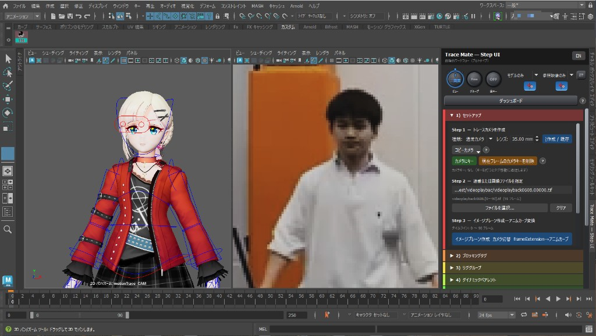

**つまずきやすい点**

- トレースカメラが無い → ステップ1からやり直す  
- 二画面が使えない → イメージプレーン作成まで完了しているか確認  

---

### 4.2 ブロッキングタグ

**目的:** 動きの区切りをタグとして残し、タイミングの研究をしやすくする。

**事前条件:** セットアップ済みであること。

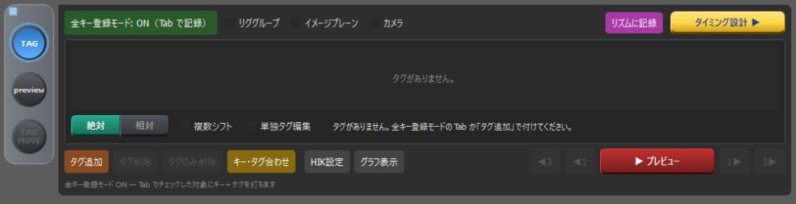

**基本操作**

1. ステップ「2) ブロッキングタグ」を開く（必要なら「パネルを開く」）  
2. **全キー登録モード**を ON にする（表示バーの「全キー」でも可）  
3. 対象（リググループ／イメージプレーン／カメラなど）にチェックを入れる  
4. **Tab** でキー＋タグを打つ、または「タグ追加」を使う  
5. 基本的にはツール上の「プレビュー」で確認します。ツール上のボタンはリググループの設定等の内部変更を自動で行ってスムースな再生を行います。

**タイミング設計・記録まわり**

タメツメやインゲームモーションにおけるタイミングの調整は大事なポイントです。  
タグを付けたあと、尺や等間隔、プレビュー／記録などのパネルでタイミングを詰められます。  
最初にリファレンスムービーのタイミングを調整し、その後モデルにアニメ設定するのが基本ですが、キーポーズを先につけてムービーと同時にタイミング調整を行うこともできます。  
「タイミング設計」や関連パネルから入れます。

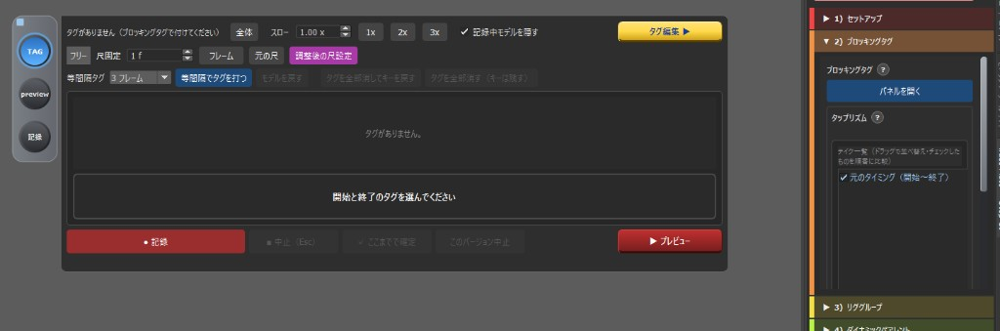

**タイミング構成**

ブロッキングタグ内に「タイミング構成」があります。クリックのタイミングでタグを並べ直す補助です。第1稿では概要のみとし、詳細は画面のヘルプ等を参考にしてください。あわせて、これからアップしていく YouTube 上の解説ムービーも参照してください。

**つまずきやすい点**

- 「タグがありません」→ Tab か「タグ追加」で付ける  
- 「タグが1つなので区間がありません」→ 区間を扱うにはタグを複数付ける  

---

### 4.3 リググループ

**目的:** キャラクターやオブジェクトに擬似的な親子関係をつくり、自由なセンターを使ったキーポーズをつくる。センターの位置や角度も途中で変更可能。  
部位をまとめて扱い、Parent（グループON）と Free（一時解除）を切り替える。

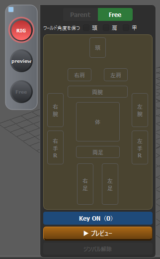

**基本操作**

1. ステップ「3) リググループ」を開く（ダッシュボードの RIG からも可）  
2. 親のオブジェクトと、現状の動きの中心になっているオブジェクト（通常は腰）を子に、足のコントローラーを所定の場所に。その他のコントローラーを最下部のリストに入れる。  
3. 部位マップで、「親に追従する」「追従しない」「キーのみ入る」対象を選ぶ。それぞれ変更可能。  
4. **Parent** / **Free** を切り替えて作業する  
5. 必要ならキーやプレビューを使う  
6. 詳細は画面のヘルプ等を参考にしてください。あわせて、これからアップしていく YouTube 上の解説ムービーも参照してください。

---

### 4.4 ダイナミックペアレント

**目的:** 親子関係が逆転するロケーターの作成機能。大きな動きの中で、それとは異なる中心点の動きをコントローラー等に追加することができる。リグとロケーター（親）の関係をスロットで管理し、有効化やベイクを行いやすくする。

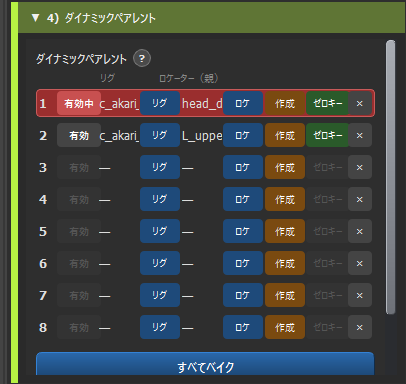

**基本操作**

1. スロットで「リグ」「ロケーター」を指定する  
2. 「作成」で関係を作る  
3. 「有効」／「有効中」で切り替え  
4. 必要に応じて「ゼロキー」「すべてベイク」  

---

### 4.5 マスターカーブ

**目的:** 区間のタイミングをカーブで見直し、キーへ反映する。  
グラフ編集のため、**別ウィンドウ表示を推奨**します。

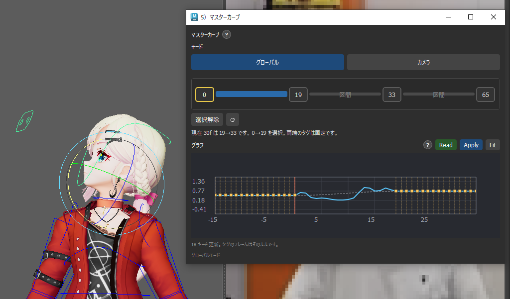

**基本操作**

1. ステップ「5) マスターカーブ」から「別ウィンドウ」で開く  
2. グローバル／カメラなどのモードを選ぶ  
3. 操作対象のオブジェクトと、操作したいグラフを選択する。  
4. 区間を選び、グラフを調整する  
5. 横方向が時間で、縦がグラフの値。同時にカーソル位置で調整する。  
6. Read / Apply などで反映し、メッセージで更新内容を確認する  

---

### 4.6 ポージング

**目的:** ポーズ A / B のあいだをスライダーで探り、キーを打つ。奥行き調整もここから始められる。

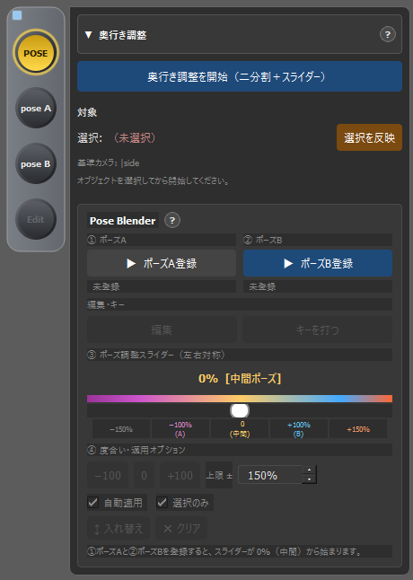

**基本操作**

1. ポーズ A・ポーズ B を登録する  
2. スライダーで中間〜強調を探る  
3. 必要なら「キーを打つ」  
4. 奥行きが必要なら「奥行き調整を開始」  

---

## 5. Optional 機能について

次は補助用です。通常の学習フローでは必須ではありません。手順の詳細は本マニュアルでは扱いません。画面のヘルプ等を参考にしてください。あわせて、これからアップしていく YouTube 上の解説ムービーも参照してください。

- ダミー作成  
- ストッパー  
- ワールドスナップ  
- キーシフト  
- 範囲アーク  
- レコーダー  

---

## 6. 画面表示・作業補助（短く）

| 項目 | 内容 |
|------|------|
| 通常 | 分割をやめたパース表示 |
| 二画面 | 左＝モデル / 右＝参照（イメージプレーン作成後） |
| 奥行き | 奥行き調整用の二分割 |
| ダッシュボード | RIG やタイミング設計などへの入口 |

---

## 7. よくある質問

**違う Maya 年の zip を使った**  
→ 動きません。[Releases](https://github.com/matu1004-ctrl/TraceMate/releases) から正しい年を取り直してください。

**トレースカメラが無い**  
→ 「1) セットアップ」を完了してください。

**シェルフにボタンが無い**  
→ `install.mel` をもう一度 D&D してください。

**入れ直したい**  
→ `scripts\TraceMate` を消してから、再度インストールしてください。

---

## 8. 付録

### ショートカット（抜粋）

| 操作 | 内容 |
|------|------|
| Tab | 全キー登録モード ON 時に、チェック対象へキー＋タグ |

### リンク

- リポジトリ: https://github.com/matu1004-ctrl/TraceMate  
- Releases: https://github.com/matu1004-ctrl/TraceMate/releases  
